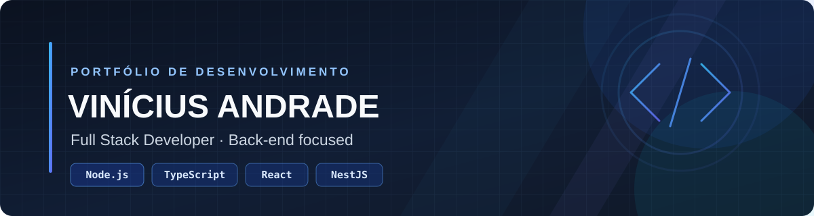

<!-- Banner do perfil -->

  

<h1 align="center">Vinícius Andrade</h1>

  <strong>Desenvolvedor Full Stack Júnior · Ênfase em Back-end</strong> 
  Node.js · TypeScript · React · NestJS · Java

  <a href="https://portifolio-viniciusandrade-dev.vercel.app/">Portfólio</a> ·
  <a href="https://www.linkedin.com/in/vinicius-andrade-dev/">LinkedIn</a> ·
  <a href="https://github.com/vinicius-andrade-dev">GitHub</a> ·
  <a href="https://www.credly.com/users/vinicius-silva-de-andrade/badges">Credenciais</a>

---

## Sobre mim

Sou estudante de **Análise e Desenvolvimento de Sistemas (ADS) na UNIUBE** e desenvolvo projetos web com foco em APIs, regras de negócio, integração com bancos de dados e interfaces modernas.

Minha stack principal está no ecossistema **JavaScript/TypeScript**, com Node.js, NestJS, React e Next.js. Também desenvolvo projetos com **Java e Spring Boot**. Busco escrever código organizado, compreender os problemas de negócio e documentar decisões técnicas para tornar as soluções mais fáceis de manter.

Tenho experiência profissional em ambientes que exigem responsabilidade, análise de riscos, organização e cumprimento de procedimentos — competências que também aplico à resolução de problemas técnicos.

**Objetivo:** oportunidades remotas de Desenvolvimento Back-end ou Full Stack Júnior.

## Tecnologias

| Área | Tecnologias |
|---|---|
| Linguagens | JavaScript, TypeScript, Java, Python, SQL, HTML e CSS |
| Back-end | Node.js, NestJS, Express, Spring Boot, APIs REST |
| Front-end | React, Next.js, Angular, Tailwind CSS |
| Dados | PostgreSQL, MySQL, MongoDB, Prisma, Mongoose |
| Ferramentas | Git, GitHub, Docker, Redis |
| Fundamentos | Autenticação e autorização, validação, testes, organização de código e segurança de aplicações |

## Projetos em destaque

### [AgendaUBS](https://github.com/vinicius-andrade-dev/AgendaUBS)
**Java · Spring Boot · Angular · PostgreSQL**

Sistema de agendamento e gestão para contexto de atenção básica em saúde. Projeto que reúne desenvolvimento de API, interface web e persistência relacional.

### [Protocolo 360](https://github.com/vinicius-andrade-dev/protocolo360)
**NestJS · TypeScript · Prisma · PostgreSQL · Redis · Next.js**

Projeto de sistema de protocolos e documentos com foco em regras de negócio, organização do backend e conceitos de arquitetura multi-tenant.

### [Sistema de Gestão de Almoxarifado](https://github.com/vinicius-andrade-dev/warehouse-mvp)
**Next.js · React · MongoDB · Mongoose · Zod**

Aplicação de gestão de estoque com cadastro de itens, categorias e fornecedores, movimentações e acompanhamento de saldo.

### [Pix Simulator](https://github.com/vinicius-andrade-dev/pix)
**NestJS · TypeScript · PostgreSQL · Prisma · Redis · Docker**

Simulador educacional para explorar conceitos de backend, consistência de operações, idempotência e concorrência. **Não realiza transações financeiras reais nem se integra ao sistema bancário/SPI.**

### [SecureHub](https://github.com/vinicius-andrade-dev/secure_hub_project)
**Python · Java · SQLite · Segurança**

Projeto demonstrativo voltado a gestão de usuários, níveis de acesso, registro de atividades e conceitos de segurança. Consulte o repositório para verificar o escopo e o estado atual da implementação.

  <a href="https://github.com/vinicius-andrade-dev?tab=repositories"><strong>Explorar todos os repositórios →</strong></a>

## Formação e certificações

- **Análise e Desenvolvimento de Sistemas (ADS)** — UNIUBE, em andamento.
- **Microsoft Azure Fundamentals (AZ-900)**.
- Certificações e trilhas Cisco em redes, segurança cibernética e análise de dados.
- Capacitações em Python e C++.

Confira as credenciais disponíveis na [Credly](https://www.credly.com/users/vinicius-silva-de-andrade/badges).

## Contato

- **Portfólio:** [portifolio-viniciusandrade-dev.vercel.app](https://portifolio-viniciusandrade-dev.vercel.app/)
- **LinkedIn:** [vinicius-andrade-dev](https://www.linkedin.com/in/vinicius-andrade-dev/)
- **GitHub:** [vinicius-andrade-dev](https://github.com/vinicius-andrade-dev)
- **Credly:** [Certificações](https://www.credly.com/users/vinicius-silva-de-andrade/badges)

---

  Projetos pessoais e acadêmicos apresentados para demonstrar aprendizado e prática de desenvolvimento. As funcionalidades e o estado de cada projeto devem ser conferidos em seu respectivo repositório.

